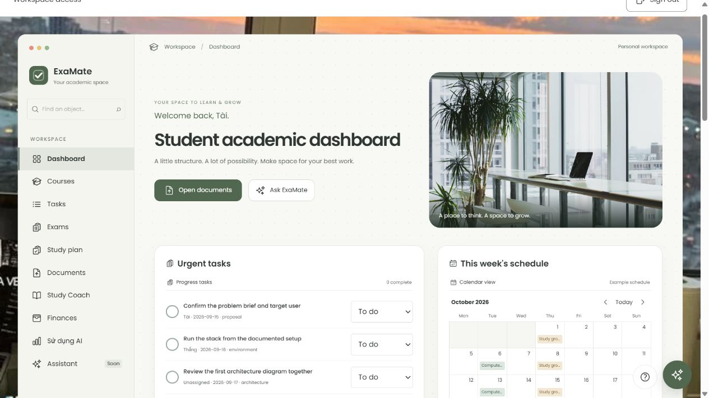
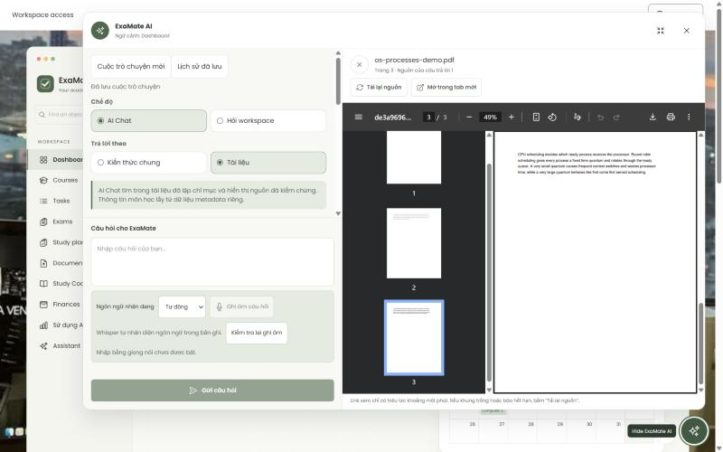
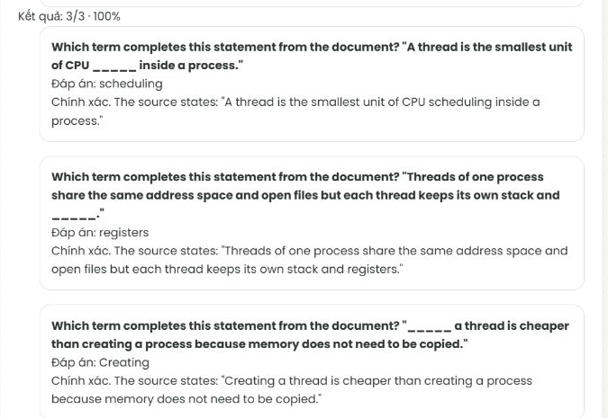

# ExaMate — defense presentation

## Recommended visual edition - 25 October 2026

[Offline HTML](submission/ExaMate-Presentation-Visual-20261025.html) and
[15-page PDF](submission/ExaMate-Presentation-Visual-20261025.pdf) follow the selected
black/white/yellow reference: grayscale local photographs, yellow frames, diagonal
contents, numbered steps, alternating panels, a circular guardrail motif and
outcome bars. Poppins and genuine Heroicons are embedded with their licenses;
there are no CDN, API, credential, analytics or storage dependencies.

This edition has **15 slides**, English content and Vietnamese notes. Eleven
retained screenshots cover Dashboard, Courses, Expenses, Documents/mobile,
Assistant/citations/history, Study Coach/quiz, STT readiness and AI Usage. Captions
distinguish real-service captures from synthetic-provider integration fixtures.
The flashcard page is explicitly an implementation illustration. The editable
24 October PPTX below remains available; it uses the older design.

Open HTML directly in Chrome/Edge. Arrow keys/Page Up/Page Down navigate; Home/End
jump to the ends. Overview shows every page; Notes shows Vietnamese speaker notes.
Fullscreen requires a user click. Narrow screens use a readable vertical layout;
the PDF always retains 16:9. With JavaScript disabled all slides remain readable.

Recommended eight-minute route: **1 -> 3 -> 5 -> 15 -> web demo -> 13 -> 14**.
Do not narrate all fifteen pages. Do not claim a complete improved evaluation:
baseline remains 15 PASS/3 FAIL/2 INCONCLUSIVE, follow-up 1 PASS/2 provider
errors/17 NOT ATTEMPTED. Evidence on slide 12 is explicitly dated; no application
measurement is inferred from a slide export.

Editable source: `docs/presentation/deck.html`, `deck.css`, `deck.js` and
`assets/provenance.json`. Rebuild with existing installed dependencies:

```powershell
node scripts/build-visual-presentation.mjs
node --test scripts/visual-presentation.test.mjs
node scripts/verify-visual-presentation.mjs
python scripts/test_visual_presentation_pdf.py
python -m unittest discover -s scripts -p test_submission_docs.py
```

The verification command uses installed Windows Chrome in a new isolated
profile and a loopback static server, exports PDF, checks all slides at five widths
and saves evidence under ignored `artifacts/presentation-visual-20261025/`.
It does not log into or exercise the application. Profile artifacts are retained;
browser/server processes created by the command are closed.

## Retained 24 October PPTX outline

English slide content; Vietnamese speaker notes. Visual revision: 24 October 2026.
Technical measurements are retained from 23 October; no new application/model run.
DRAFT: improved evaluation and personal confirmations remain incomplete.
14 slides including 2 Q&A backups; rubric limit 15. Slides 13–14 are hidden by
default in the PowerPoint slide show and remain visible in the PDF.

Editable PPTX and PDF: `docs/submission/ExaMate-Presentation-20261024.{pptx,pdf}`.
Build: `python scripts/build-defense-slides.py output/presentation`.
The dedicated command creates the designed deck; the older generic exporter only
provides a basic outline. Notes are embedded in PowerPoint. Evidence bindings:
`submission/report-evidence.json` and `report-assets/figure-provenance.json`.

Eight-minute route: slides 1–3 briefly → slide 5 → real web demo → slides 10 and 12.
Other slides support explanations; 13–14 are optional Q&A backups. Do not read every
slide during the eight minutes. No backup video is claimed or embedded.

## ExaMate

- AI academic workspace
- Study from your sources. Verify what AI says.
- Tài + Thắng
- New Technologies in Software Engineering · 2026–2027
- A · Grounded document Q&A
- C · Structured study practice

> TÀI · 15 giây. “ExaMate giúp sinh viên quản lý việc học, hỏi đáp trên tài liệu có dẫn nguồn và luyện tập từ nội dung có cấu trúc. Hai capability nhóm trình bày là A và C.” Không nhận B có ba LLM-called tools. Không tự nói đã đạt rubric.
> Tuyến 8 phút: 1–3 → 5 → demo web → 10 → 12. Các trang khác để minh họa hoặc vấn đáp. DRAFT vì so sánh evaluation chưa đủ và còn xác nhận cá nhân.

## From scattered files to a study loop

- Organize | Tasks, courses, exams, plans, expenses and documents.
- Verify | Ask within an authorized source; inspect the cited PDF page.
- Practise | Preview, explicitly save, then review personal progress.
- One workspace. A traceable learning loop.
  

> TÀI · 10–15 giây. Tài liệu rải rác, câu trả lời khó kiểm nguồn, đầu ra AI chưa có chỗ luyện tập: nhóm nối thành một luồng. Ảnh là bản dùng Supabase thật đã chụp trước đó, không phải output Gemini mới. Courses hiện đọc, Tasks chưa có xóa; không nói mọi module đầy đủ CRUD.

## Architecture with explicit trust boundaries

- Browser | React + TypeScript · Vite · responsive UI
- API | NestJS · verified session · membership · validation
- Database | PostgreSQL + pgvector · scoped queries + RLS
- Identity + files | Supabase Auth / Google · private Storage
- AI services | Gemini embedding + generation · local Whisper STT
- Business and Auth use separate non-owner runtime LOGINs.

> THẮNG · 25–30 giây. React gọi Nest qua proxy; backend giữ key, xác minh quyền trước SQL/file/AI. Supabase không thay toàn bộ business logic. Gemini phục vụ embedding/generation; Whisper chạy trên API host local, không phải browser. Không giữ DB transaction lúc chờ provider. Tài bổ sung Auth/RLS hiện tại nếu hỏi sâu.
> Thắng có phần nền backend/Supabase và Gemini ban đầu; Tài phát triển/tích hợp tiếp Auth/RLS, RAG và managed deployment. Không gán toàn bộ backend hiện tại cho một commit cũ.

## Capability A: answer from authorized evidence

- 01 · Ingest | Ready PDF → page-bounded chunks → 768-dimensional vectors.
- 02 · Retrieve | Scope first; keep up to six qualifying evidence chunks.
- 03 · Validate | Answer shape, source IDs and inline markers must agree.
- 04 · Inspect | Open the cited PDF page with fresh scoped access.
- No qualifying evidence → refusal, without answer generation.
- Query embedding may already have run. Valid citations do not prove every claim.
  

> TÀI · Trang hỗ trợ giải thích. Chunk target 1200, max 1800, overlap 200 ký tự, page-bounded. Embedding không tạo answer. Tài liệu Ready không bảo đảm mọi trang trích xuất tốt. Citation hợp lệ về ID/page không chứng minh claim được nguồn hỗ trợ.
> Ảnh integration lịch sử: Nest/PDF.js/retrieval/PG17 thật; Auth upstream, Storage và provider tổng hợp. Minh họa PDF trang 3, không chứng minh chất lượng Gemini. Xem figure-provenance.json.

## Live demo: verify one answer

- 1 · Persist | Update a task, reload and confirm the stored change.
- 2 · Ask | Select the ready operating-systems PDF and ask the question below.
- 3 · Verify | Open page 3; then ask an out-of-document question.
- 4 · Practise | Quiz preview → confirm → submit → progress; flip a saved card.
- What happens when the Round Robin time quantum is very small?
- http://127.0.0.1:8080

> TÀI → THẮNG → TÀI · Chuyển sang web. Tài task/RAG, Thắng SSE/STT, Tài Study Coach. Kịch bản chi tiết trong DEMO-AND-DEFENSE.md. Chọn os-processes-demo.pdf Ready; đối chiếu trang 3. Câu ngoài tài liệu: “Ai đã vẽ bức Mona Lisa?”. Không đọc đáp án soạn trước nếu output thực tế khác.
> Generation chỉ khi ngân sách/provider cho phép, không bấm lại khi lỗi. Nếu mở quiz đã lưu, nói rõ là bản lưu. Không mở .env, cookie hoặc credential. Trong 8 phút không cần chiếu hết 14 trang; slide này giữ làm điểm chuyển sang browser.

## Capability C: preview becomes usable practice

- Preview | Ready document · count/language · evidence-bound JSON.
- Confirm | Explicit save of a server-issued draft; private immutable snapshot.
- Quiz | Server grades stored answers; attempts and progress persist.
- Flashcards | Flip → self-rate → explicitly save a completed review.
- Practice and progress do not call AI.
- Flashcard ratings are self-assessment, not an AI grade or proof of mastery.
  

> TÀI · Preview chưa là bộ được xác nhận; draft server đã validate có token, hết hạn 15 phút. Nguồn phải thuộc evidence. Khi nộp quiz, server chấm từ snapshot, không tin score client. Flashcards remembered/needs_review là tự đánh giá. Confirm/attempt/review có idempotency và recovery; không gọi lại AI để cứu lỗi lưu.
> Ảnh 3/3 là integration dùng provider tổng hợp, server/DB thật; không phải benchmark chất lượng Gemini ra đề. Demo nội dung thực tế, không đọc điểm cố định.

## Streaming and local voice, under user control

- SSE | General chat streams text; Stop aborts and ignores late output.
- Document policy | Stream status; publish the answer after source checks.
- Local STT | Record → inspect → Whisper → edit → insert → send yourself.
- Runtime limits | 60 s audio · 120 s inference · 150 s request · 180 s outer wait.
- Speech input does not make the whole application offline.
- Physical microphone and Vietnamese accuracy still need acceptance.

> THẮNG · Cho thấy general phát dần, Stop; STT ghi ngắn, sửa/chèn, không tự gửi. Luồng MediaRecorder → API → ffprobe/FFmpeg → mono 16 kHz → Whisper small ONNX CPU/q8. Window 30 giây, stride 5 giây để bao phủ audio dài trong giới hạn. Audio tới API host local, không gửi Gemini trong STT; nếu sau đó gửi transcript hỏi AI thì text đi theo chat contract.
> SSE dùng fetch POST/ReadableStream, parser chịu frame và UTF-8 bị chia, nginx không buffering, có backpressure/cancel. Stop không bảo đảm upstream chưa tính phí. Deadline bản cuối là chỉnh sửa tích hợp sau code STT gốc. Chỉ demo micro sau khi tự thử ổn; English fixture/readiness không chứng minh accuracy tiếng Việt thực tế.

## Guardrails protect access and uncertain outcomes

- Scope | Server principal + current membership + RLS; never trust a client role.
- Evidence | Treat document text as untrusted; refuse unsupported answers.
- Validation | Reject malformed structure or invented sources; no silent repair loop.
- Recovery | Keep submission identity after uncertain writes; reconcile safely.
- AI failure is visible; independent non-AI screens remain usable.
- Injection resistance is inconclusive without the exact model context.

> TÀI / THẮNG · Không chỉ ẩn nút viewer; backend kiểm quyền, manager không đọc quiz/hội thoại cá nhân người khác. COMMIT có thể xong nhưng mất response: giữ key/payload, confirm unknown GET trước write tiếp, attempt/review retry cùng key. Không tự tạo lượt mới hoặc gọi AI lại.
> Injection là dữ liệu không tin cậy; prompt/citation giảm rủi ro, không bảo đảm miễn nhiễm. Hai case thiếu trace giữ INCONCLUSIVE. Không đổi key sai hoặc cố hết quota để dựng lỗi. Chỉ nói lỗi đang xảy ra khi quan sát thật; ảnh/log cũ phải ghi là bằng chứng trước đó.

## Verification: identify what each layer proves

- Application | 2,324 passes: API Vitest 460 + API Node 1,317 + Web 547.
- Database | PG17 canonical 521/521; managed fixture 1/1 reported separately.
- Real services | Docker + managed026 + Google login; 45 retained HTTP checks.
- Browser fixtures | Real Nest/PG17; synthetic upstreams for selected workflows.
- These are 23 October records, not fresh execution for this export.
- Unit or fixture passes do not establish semantic model quality.

> TÀI · 2324/521 là publication trước, không phải chạy lại khi tạo slide. Phân biệt browser synthetic với cloud real. Backend/PG thật không biến synthetic model thành Gemini. Google/Docker/HTTP thật có evidence riêng; chưa nghiệm thu toàn bộ browser matrix. Nguồn report-evidence.json.

## Live evaluation: baseline and incomplete follow-up

- Baseline | 20 cases: 15 strict PASS · 3 FAIL · 2 injection INCONCLUSIVE.
- Follow-up | 1 PASS · 2 provider HTTP503 errors · 17 NOT ATTEMPTED.
- Controlled change | Retrieval threshold 0.55 → 0.50; same model, corpus and prompt.
- Review | Frozen expected facts; AI-assisted technical review under delegation.
- A complete before/after quality claim is not yet supported.
- Semantic content 18/20 is separate, not a replacement for strict results.

> TÀI · 25 giây cuối demo. Giữ mẫu số 20 và phân biệt provider error với semantic FAIL. Chưa đủ mẫu sau để kết luận cải thiện. Không sửa gold sau output. Baseline 15 strict PASS/3 FAIL/2 INCONCLUSIVE; semantic-content 18/20 là thước đo khác.
> Corpus synthetic ASCII minh họa, không phải rubric hay quy định thật. Injection thiếu exact context vẫn INCONCLUSIVE. Reviewer AI theo ủy quyền, không giả human review/chữ ký Tài–Thắng. Chart lấy số từ report-evidence.json, không thay đổi gold.

## Cost and latency: known values, stated limits

- Mean operation | 4.58 s across 20 baseline operations.
- Sample p95 | 5.06 s across the same 20; not a production SLA.
- Known generation estimate | USD 0.0128272 across 20 generations with usage.
- Coverage | 20 of 40 baseline provider calls had missing usage; missing is not zero.
- Campaign upper used/reserved | USD 0.618895 across 51 calls, including a separate probe.
- Estimates are not invoices. One successful follow-up sample is not comparable.

> TÀI · Dùng nếu thầy hỏi số liệu. Operation latency khác provider latency/TTFT. Mẫu 20 không chứng minh SLA. Known cost chỉ generation có usage; không cộng embedding/error thiếu usage thành 0. Campaign upper used/reserved là dự trù bảo thủ, không phải hóa đơn hay Google hard cap. Probe model khác không ghép denominator đánh giá chất lượng.
> Nguồn report-evidence.json. Không đọc số dashboard tổng hiện tại thành baseline. Không gọi mới model chỉ để cập nhật slide.

## Two contributors, one integrated product

- Tài | Final integration, frontend/business screens, Auth/RLS, RAG, Study Coach, AI controls and evaluation.
- Thắng | Early backend/Supabase, initial Gemini integration, local STT and SSE.
- Shared integration | Assistant and deployment evolved; AI assistance is disclosed.
- Delivered | Source-verifiable Q&A and persistent personal study workflows.
- Still open | Full follow-up evaluation, broader semantic/device checks and personal confirmations.
- Thank you. We can trace a request from the UI to its source and saved result.

> CẢ HAI · 15–20 giây kết. Tài chốt RAG/Study Coach; Thắng chốt backend ban đầu/SSE/STT. Ownership theo nội dung Git, không tính phần trăm công sức bằng số commit. Thắng có b4ce829, d2ca5ca, 917edc7, b988e26, 2249abf; deadline/hardening có tích hợp sau. Chỉ nhận phần thực sự làm và hiểu, không bịa lý do commit ít.
> Không tự kết luận rubric passed hoặc full F08/F09 accepted; không TTS/third LLM tool. Xác nhận cá nhân do chính người đó nói. Sẵn sàng mở code, không mở credential.

## Backup: frontend request lifecycle

- UI | Components render views; hooks own state/effects; api.ts centralizes requests.
- Identity | Principal/context query keys prevent old private data flashing back.
- Request | Debounce → bounded GET → server page/count and scoped lookup.
- Race guard | Abort + revision/key checks reject late responses.
- Contract | Shared .d.ts catches compile-time drift, not runtime invalid data.
- Code anchors | use-paged-search.ts · use-assistant.ts · api.ts · packages/contracts/index.d.ts

> TÀI · Chỉ mở nếu hỏi FE. State ảnh hưởng render; ref giữ revision mà không tự render; effect cleanup hủy request/listener. A về sau B không đè B. Query mới page 1 từ request đầu, không tải full list rồi slice. UI gating không thay backend authorization. Dùng hash navigation, không nói React Router. Chỉ một test stale-response hoặc attempt unknown để giải thích cụ thể.

## Backup: code and decisions to defend

- RAG | document-chunker.ts → rag-retrieval.service.ts → assistant.service.ts
- Study Coach | study-quiz-validation.ts · study-coach.service.ts · study-flashcards.service.ts
- Voice + SSE | audio-inspector.ts · local-speech-runtime.ts · assistant-stream.ts
- Auth + AI controls | auth.guard.ts · ai-admission.service.ts · ai-usage.service.ts
- Trade-offs | Hosted Auth; bounded context vs coverage; CPU speech vs cloud dependence.
- One honest answer | Show a function, explain one regression and name one remaining limit.

> CẢ HAI · Backup vấn đáp. Tài mở RAG/Study Coach/Auth/controls; Thắng mở STT/SSE. Code trong apps/api/src/{documents,assistant,study-coach,speech,auth} và apps/web/src. Xem DEMO-AND-DEFENSE.md: 17 câu Tài, 19 câu Thắng, có ý trả lời.
> Chọn lỗi AI mình hiểu: evaluator PASS khi thiếu output hoặc executor tin binding mutable. Giải thích oracle RED→GREEN; không nhận test cũ là vừa chạy. Hai slide backup không phải phần cần đọc trong 8 phút.
